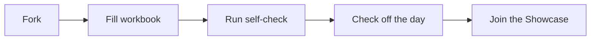
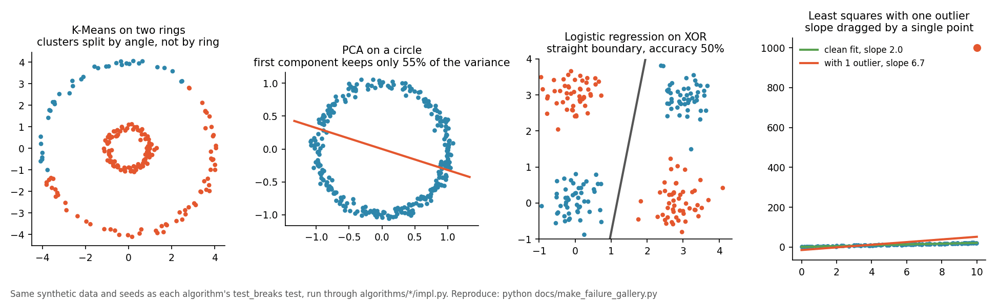

# Tiny ML Lab

[](https://github.com/RishabhPande/tiny-ml-lab)
[](https://github.com/RishabhPande/tiny-ml-lab)
[](https://github.com/RishabhPande/tiny-ml-lab)
[](https://github.com/RishabhPande/tiny-ml-lab/actions/workflows/tests.yml)

**Fork it, fill the workbooks, check off the days.**

One famous ML algorithm a day, each in a single file, numpy only, done in under 60 seconds. Every algorithm comes with two tests: one that proves it works, and one that breaks it, so you learn exactly where each method fails.

This repo is work to do, not just code to read. Every folder has a `workbook.py` with TODO bodies: fill it in, run it to check yourself, then peek at `impl.py` if you get stuck.

## 🔁 How it works



## ⚡ 60-second quickstart

```bash
git clone https://github.com/RishabhPande/tiny-ml-lab.git
cd tiny-ml-lab
pip install -r requirements.txt
pytest
python algorithms/kmeans/impl.py
```

## Check your workbooks together

```bash
python scripts/check_workbooks.py                         # all days
python scripts/check_workbooks.py perceptron kmeans       # selected folders
python scripts/check_workbooks.py --json > workbook-status.json
```

The runner finds workbook folders automatically and runs each in a fresh Python
process from its own directory. It reports `todo`, `error`, `timeout`,
`unrecognized`, or `self-check-ok`. Unfilled workbooks print TODO feedback but
normally exit zero; this runner checks their feedback instead of treating that
zero as completion. Exit codes: 0 only when every selected self-check is OK,
1 when work remains or a check fails, 2 for invalid arguments.

**Self-check OK is not correctness grading.** It only means the workbook's
existing checks ran without their TODO/error feedback. The algorithm tests use
`impl.py`, not your workbook, so passing those tests does not grade your solution
either. Review your implementation and compare behavior before checking off
`PROGRESS.md`. This command never fills TODOs or edits your checklist.

Use only trusted local workbooks: running them executes Python with your own
permissions, not in a sandbox. The default 60-second timeout per workbook stops
the direct process, not arbitrary child processes or network access. Change it
with `--timeout SECONDS`. JSON includes only folder names and statuses, not
workbook output or exception details. No extra dependencies are needed.

## 📅 The days

| Day | Algorithm | One-liner |
| --- | --- | --- |
| 1 | [Linear Regression](algorithms/linear-regression/) | Closed-form least squares, and how one outlier bends it |
| 2 | [K-Means](algorithms/kmeans/) | Lloyd's algorithm, and why it fails on rings |
| 3 | [K-Nearest Neighbors](algorithms/knn/) | Majority vote by distance, and the curse of noisy dimensions |
| 4 | [Gaussian Naive Bayes](algorithms/naive-bayes/) | Independent-feature classification, and what duplicated features do to it |
| 5 | [Decision Tree](algorithms/decision-tree/) | CART-style splits, and how an unlimited tree memorizes noise |
| 6 | [PCA](algorithms/pca/) | Eigendecomposition, and why it cannot see a circle |
| 7 | [Tiny Neural Net](algorithms/tiny-nn/) | A numpy MLP that solves XOR, and why scaling matters |
| 8 | [Logistic Regression](algorithms/logistic-regression/) | Gradient descent on log loss, and why a straight line cannot solve XOR |
| 9 | [Random Forest](algorithms/random-forest/) | Bagged trees with random feature subsets, and how majority vote erases a rare class |
| 10 | [DBSCAN](algorithms/dbscan/) | Density clustering, and why one radius cannot handle varying densities |
| 11 | [Gradient Boosting](algorithms/gradient-boosting/) | Stumps fit to residuals, and why trees cannot extrapolate |
| 12 | [PageRank](algorithms/pagerank/) | Random-surfer ranking, and why a closed loop traps all the rank |
| 13 | [Support Vector Machine](algorithms/svm/) | Maximum-margin linear classifier, and why a straight boundary cannot solve XOR |
| 14 | [Gaussian Mixture Model](algorithms/gmm/) | Soft clustering by EM, and why overlapping blobs cannot be told apart |
| 15 | [Hidden Markov Model](algorithms/hmm/) | Baum-Welch and Viterbi decoding, and why identical emissions hide the state |
| 16 | [Attention](algorithms/attention/) | Scaled dot-product self-attention, and why identical keys collapse it to a mean |
| 17 | [LoRA](algorithms/lora/) | Low-rank adapters on a frozen layer, and why a rank-1 update cannot fix a full-rank task |
| 18 | [RAG Retriever](algorithms/rag-retriever/) | TF-IDF cosine retrieval, and why synonyms it never saw return nothing |
| 19 | [Autoencoder](algorithms/autoencoder/) | A tiny MLP that compresses and rebuilds, and why a 1D bottleneck cannot hold a circle |
| 20 | [Q-Learning](algorithms/q-learning/) | Tabular Q-learning on a gridworld, and why a myopic agent never finds a delayed reward |
| 21 | [Isolation Forest](algorithms/isolation-forest/) | Random splits that isolate outliers fast, and why a tight cluster of anomalies hides itself |
| 22 | [Perceptron](algorithms/perceptron/) | The original linear learner, and why it never settles on XOR |
| 23 | [AdaBoost](algorithms/adaboost/) | Boosted stumps that correct each other, and why label noise turns the reweighting against it |
| 24 | [Ridge Regression](algorithms/ridge-regression/) | L2-penalized least squares that tames collinear features, and why too much penalty erases the signal |
| 25 | [Lasso Regression](algorithms/lasso-regression/) | L1-penalized least squares that zeroes useless features, and why it hands a shared effect to one twin feature |
| 26 | [Elastic Net](algorithms/elastic-net/) | L1 and L2 penalties mixed, and why a feature recorded in tiny units gets priced out and deleted |
| 27 | [Hierarchical Clustering](algorithms/hierarchical-clustering/) | Agglomerative merging bottom up, and why a thin chain of points joins two far apart clusters |
| 28 | [Spectral Clustering](algorithms/spectral-clustering/) | Eigenvectors of the graph Laplacian, and why a tiny sigma dissolves the graph it clusters |
| 29 | [t-SNE](algorithms/tsne/) | A neighbor preserving map to 2D, and why the distances between clusters on the map mean nothing |
| 30 | [Linear Discriminant Analysis](algorithms/lda/) | Projection that separates class means, and why classes with the same mean are invisible to it |
| 31 | [Quadratic Discriminant Analysis](algorithms/qda/) | One Gaussian per class with its own covariance, and why a handful of points per class cannot pin that covariance down |
| 32 | [Independent Component Analysis](algorithms/ica/) | FastICA unmixing by non-Gaussianity, and why Gaussian sources cannot be unmixed at all |
| 33 | [Non-Negative Matrix Factorization](algorithms/nmf/) | Multiplicative updates that split a non-negative matrix into parts, and why too few parts cannot rebuild a higher-rank matrix |
| 34 | [Mean Shift](algorithms/mean-shift/) | Walks uphill to density peaks, and why a window wider than the gap merges two clusters into one |
| 35 | [Gaussian Process Regression](algorithms/gaussian-process/) | Kernel-weighted regression with error bars, and why a length scale wider than the data flattens the curve |
| 36 | [Factor Analysis](algorithms/factor-analysis/) | A few hidden factors plus per-variable noise, and why one factor cannot stand in for two independent ones |
| 37 | [Self-Organizing Map](algorithms/self-organizing-map/) | A grid of prototypes that unfolds over the data, and why one unit cannot stand in for three far apart clusters |

## 💥 Where they break



*Four of the ten `test_breaks` tests, drawn from this repo's own `impl.py` files on the same synthetic data and seeds. Regenerate with `python docs/make_failure_gallery.py` (needs matplotlib; the algorithms stay numpy only).*

## 📏 The rules

- One file per algorithm (`impl.py`), numpy only, no downloads.
- Every demo runs in under 60 seconds on synthetic data with a fixed seed.
- Every algorithm has a `test_works` test (a real numeric assertion) and a
  `test_breaks` test (a real failure mode).
- Every algorithm has a `workbook.py`: the same API with TODO bodies and a
  standalone self-check. Fill it in yourself before reading `impl.py`.

## 🙌 How to take part

- Start here: copy [PROGRESS.md](PROGRESS.md) into your fork and check days
  off there as you finish them.
- Want the next algorithm? Vote in [REQUESTS.md](REQUESTS.md).
- Want to add an algorithm? Read [CONTRIBUTING.md](CONTRIBUTING.md).
- Finished days in your fork? Add yourself to the
  [Fork Hall of Fame](SHOWCASE.md).

## License

MIT. See [LICENSE](LICENSE).
