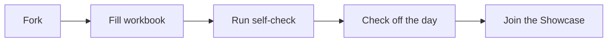

# Tiny ML Lab

[](https://github.com/RishabhPande/tiny-ml-lab)
[](https://github.com/RishabhPande/tiny-ml-lab)
[](https://github.com/RishabhPande/tiny-ml-lab)
[](https://github.com/RishabhPande/tiny-ml-lab/actions/workflows/tests.yml)

**Fork it, fill the workbooks, check off the days.**

One famous ML algorithm a day, each in a single file, numpy only, done in under 60 seconds. Every algorithm comes with two tests: one that proves it works, and one that breaks it, so you learn exactly where each method fails.

This repo is work to do, not just code to read. Every folder has a `workbook.py` with TODO bodies: fill it in, run it to check yourself, then peek at `impl.py` if you get stuck.

## 🔁 How it works



## ⚡ 60-second quickstart

```bash
git clone https://github.com/RishabhPande/tiny-ml-lab.git
cd tiny-ml-lab
pip install -r requirements.txt
pytest
python algorithms/kmeans/impl.py
```

## 📅 The days

| Day | Algorithm | One-liner |
| --- | --- | --- |
| 1 | [Linear Regression](algorithms/linear-regression/) | Closed-form least squares, and how one outlier bends it |
| 2 | [K-Means](algorithms/kmeans/) | Lloyd's algorithm, and why it fails on rings |
| 3 | [K-Nearest Neighbors](algorithms/knn/) | Majority vote by distance, and the curse of noisy dimensions |
| 4 | [Gaussian Naive Bayes](algorithms/naive-bayes/) | Independent-feature classification, and what duplicated features do to it |
| 5 | [Decision Tree](algorithms/decision-tree/) | CART-style splits, and how an unlimited tree memorizes noise |
| 6 | [PCA](algorithms/pca/) | Eigendecomposition, and why it cannot see a circle |
| 7 | [Tiny Neural Net](algorithms/tiny-nn/) | A numpy MLP that solves XOR, and why scaling matters |

## 📏 The rules

- One file per algorithm (`impl.py`), numpy only, no downloads.
- Every demo runs in under 60 seconds on synthetic data with a fixed seed.
- Every algorithm has a `test_works` test (a real numeric assertion) and a
  `test_breaks` test (a real failure mode).
- Every algorithm has a `workbook.py`: the same API with TODO bodies and a
  standalone self-check. Fill it in yourself before reading `impl.py`.

## 🙌 How to take part

- Start here: copy [PROGRESS.md](PROGRESS.md) into your fork and check days
  off there as you finish them.
- Want the next algorithm? Vote in [REQUESTS.md](REQUESTS.md).
- Want to add an algorithm? Read [CONTRIBUTING.md](CONTRIBUTING.md).
- Finished days in your fork? Add yourself to the
  [Fork Hall of Fame](SHOWCASE.md).

## License

MIT. See [LICENSE](LICENSE).
